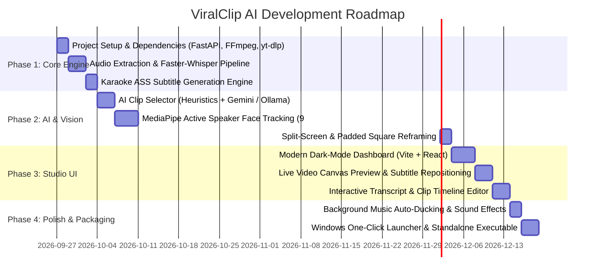

# Product Requirement Document (PRD)

## Project: **ViralClip AI (AutoClip Next-Gen)**
**An Intelligent, Automated Long-to-Shorts Video Repurposing Studio**

---

## 1. Executive Summary

### 1.1 Vision & Problem Statement
Content creators, podcasters, educators, and social media agencies spend hours manually cutting 30–60 minute videos into engaging 30–60 second vertical shorts (Reels, TikTok, YouTube Shorts). Existing commercial solutions (e.g., Opus Clip, Munch, Klap) require expensive monthly subscriptions and cloud uploads of large gigabyte files. 

Existing open-source/local tools (such as **AutoClip V2**) proved the concept of running 100% locally with `yt-dlp`, `faster-whisper`, and `ffmpeg`. However, they suffer from critical limitations:
- **Static center cropping** (frequently crops out speakers when they move or in multi-person interviews).
- **Basic heuristic selection** (cuts video based on generic pause detection rather than emotional hooks, humor, or punchlines).
- **Rigid UI** (lacks interactive clip timeline editing, manual subtitle correction, or real-time preview before rendering).

**ViralClip AI** is an advanced, hybrid local/cloud video repurposing engine designed to ingest any video, detect viral hooks, track speakers dynamically, generate animated karaoke subtitles, and export production-ready vertical shorts with zero or minimal cost.

---

## 2. Product Objectives & Success Metrics

| Metric | Target Goal |
| :--- | :--- |
| **Pipeline Speed** | Process a 10-minute 1080p video into 3 clips in < 3 minutes (with GPU) |
| **Speaker Retention** | > 95% face centering accuracy using dynamic AI face tracking |
| **Subtitles Accuracy** | > 98% accuracy with word-level sync and punctuation restoration |
| **Cost Flexibility** | 100% Free & Offline mode (Faster-Whisper + Ollama) OR Ultra-Smart Cloud mode (Gemini Flash multimodal) |
| **Ease of Use** | Single-click "Paste URL -> Get 3 Ready Shorts" workflow with fine-tuning studio |

---

## 3. User Personas & Use Cases

1. **Solo Content Creator / Podcaster**:
   - *Needs*: Wants to paste their YouTube podcast link and automatically receive 3–5 vertical clips with trendy subtitles to post on Instagram Reels and TikTok.
2. **Social Media Manager / Agency**:
   - *Needs*: Bulk video upload, split-screen multi-speaker layout, custom brand fonts, and fast batch export.
3. **Privacy-Conscious / High-Volume Editor**:
   - *Needs*: Completely offline, local processing without sending confidential footage to third-party servers.

---

## 4. Architecture & System Overview

```
                                  [ Input Sources ]
                            YouTube URL / File Upload (.mp4/.mov)
                                          │
                                          ▼
                               [ Ingestion Engine ]
                       yt-dlp (URL) / Chunked Uploader (Local)
                                          │
                    ┌─────────────────────┴─────────────────────┐
                    ▼                                           ▼
             [ Video Stream ]                            [ Audio Stream ]
            1080p/4K Original                          16kHz WAV Audio
                    │                                           │
                    │                                           ▼
                    │                                 [ Transcription Engine ]
                    │                              faster-whisper / WhisperX
                    │                               (Word-level Timestamps)
                    │                                           │
                    ▼                                           ▼
        [ Vision Analysis Engine ]                  [ AI Hook & Viral Selector ]
    • MediaPipe Face/Speaker Tracking         • Mode A: Local Heuristics + Ollama
    • Scene Detection & Active Speaker        • Mode B: Gemini 2.0 Multimodal Hook
                    │                                           │
                    └─────────────────────┬─────────────────────┘
                                          │
                                          ▼
                              [ Interactive Studio UI ]
                   • Live Timeline Editor  • Subtitle Text/Color Editor
                   • Aspect Ratio Switcher • B-Roll & Music Controls
                                          │
                                          ▼
                               [ Rendering Engine (FFmpeg) ]
                    • 9:16 Dynamic Pan & Scan / Split-Screen
                    • Animated Karaoke Subtitles (ASS Engine)
                    • Auto-Ducked Background Music
                    • NVENC / QuickSync / CPU Hardware Acceleration
                                          │
                                          ▼
                                  [ Export / Preview ]
                             Download Ready MP4 Shorts
```

---

## 5. Detailed Functional Requirements

### Module 1: Video Ingestion & Audio Extraction
- **FR-1.1 Web Ingestion**: Support YouTube, X (Twitter), Instagram, Vimeo, and direct MP4 URLs via embedded `yt-dlp`.
- **FR-1.2 Local File Ingestion**: Support drag-and-drop file upload (`.mp4`, `.mov`, `.mkv`, `.avi`, `.webm`) with chunked streaming upload to handle files up to 10 GB.
- **FR-1.3 Audio Preprocessing**: Extract high-fidelity 16kHz mono audio stream (`.wav`), perform audio normalization (EBU R128 standard) for consistent transcription accuracy.

### Module 2: High-Precision Transcription & Speaker Diarization
- **FR-2.1 Speech-to-Text**: Run `faster-whisper` (`base`, `small`, `medium`, `large-v3`) with full CUDA GPU auto-detection and CPU fallback.
- **FR-2.2 Word-Level Timestamps**: Every recognized word must contain `start_time` and `end_time` (down to milliseconds) for synchronizing animated subtitles.
- **FR-2.3 Multilingual & Transliteration**: Support English, Hindi, Hinglish (Latin script Hindi via `indic-transliteration`), Spanish, and 90+ Whisper languages.
- **FR-2.4 Speaker Diarization**: Detect multiple speakers (Speaker 0, Speaker 1) to enable dynamic podcast camera switching.

### Module 3: AI Viral Moment & Hook Detection
- **FR-3.1 Dual-Engine Architecture**:
  - **Local Mode (Free & Offline)**: Heuristic scoring based on speech energy, cadence, laugh detection, and local LLM (Ollama with Llama 3 / Mistral) extracting structured JSON clip segments.
  - **Smart Cloud Mode (Gemini 2.0 Flash / Pro)**: Passes audio/transcript (or direct video clip) to Gemini to evaluate:
    - *Hook Strength (0–100)*: Does the first 3 seconds grab attention?
    - *Flow & Coherence*: Does the clip make sense as a standalone story?
    - *Emotional Climax*: Identifying jokes, shocking facts, debates, or punchlines.
- **FR-3.2 Clip Output Metadata**: Each candidate clip output includes `title`, `hook_rating`, `start_time`, `end_time`, `virality_reason`, and `suggested_caption`.

### Module 4: Intelligent Visual Framing & Face Tracking
*(Significant upgrade over AutoClip V2)*
- **FR-4.1 Dynamic Face Tracking**: Instead of static center crop, use **MediaPipe Face Mesh / YOLO-Face** to detect the speaker's face coordinates per frame.
- **FR-4.2 Smooth Camera Panning**: Apply moving average damping so the 9:16 vertical viewport smoothly follows the speaker without jittering or abrupt jumps.
- **FR-4.3 Multi-Speaker Layouts**:
  - *Auto-Switch Mode*: Cut camera to whoever is currently talking.
  - *Split-Screen Mode (Podcast Layout)*: Top 50% displays Speaker A, bottom 50% displays Speaker B with a sleek divider.
  - *1:1 Padded Square*: Original video centered with blurred/frosted-glass top and bottom background.

### Module 5: Viral Animated Subtitles Engine
- **FR-5.1 High-Impact Presets**:
  - **The Hormozi**: Bold uppercase font (Montserrat/TheBoldFont), bright yellow & green active word bounce with thick black outline.
  - **MrBeast Vibrant**: Playful font with rotating subtle tilt and multi-color word glow.
  - **Clean Minimalist**: Inter font with elegant underline or pill background.
  - **Cyberpunk / Neon**: High-contrast glowing neon text.
- **FR-5.2 Keyword Highlighting**: Automatically detect key emphasized nouns/adjectives and assign contrasting accent colors.
- **FR-5.3 Dynamic Emoji Insertion**: Contextual emojis auto-placed alongside words (e.g., 🚀 for "growth", 💰 for "money", 😱 for "shocking").
- **FR-5.4 ASS Subtitle Rendering**: Generate Advanced SubStation Alpha (`.ass`) subtitle files with custom styling tags (`\k` karaoke tags) burned losslessly via FFmpeg.

### Module 6: Audio Polish & Background Music
- **FR-6.1 Royalty-Free Music Library**: Bundled library of Lo-Fi, Phonk, Cinematic, and Upbeat royalty-free background tracks.
- **FR-6.2 Smart Auto-Ducking**: Automatically reduce background music volume by -18dB whenever speech is active, and smoothly fade up during speech pauses.

### Module 7: Interactive Studio UI (Frontend)
- **FR-7.1 Live Preview Player**: Interactive HTML5 video canvas displaying real-time subtitle placement, drag-to-reposition subtitles, and font size adjustment.
- **FR-7.2 Transcript Editor**: Editable transcript where clicking any word seeks the video player to that exact millisecond. Users can edit misspelled words before burning.
- **FR-7.3 Batch Processing Queue**: View processing progress for multiple clips in parallel with live status indicators (Download -> Transcribe -> Track -> Render).

---

## 6. Technical Stack & Specifications

| Layer | Technology Selected | Rationale |
| :--- | :--- | :--- |
| **Backend Framework** | Python 3.11+, FastAPI, Pydantic v2 | High-performance asynchronous REST API with automatic OpenAPI documentation |
| **Video Engine** | FFmpeg 6.0+ (Bundled) + `ffmpeg-python` | Industry gold standard for video cutting, filtering, overlaying, and hardware encoding |
| **Hardware Acceleration** | NVIDIA NVENC (`h264_nvenc`) / Intel QSV / CPU `libx264` | Fast export rendering utilizing host GPU if available |
| **Speech AI** | `faster-whisper` (CTranslate2) | 4x faster transcription than standard OpenAI Whisper with 50% less VRAM |
| **Computer Vision** | `mediapipe` / `opencv-python` | Ultra-fast, lightweight real-time face detection for 9:16 auto-tracking |
| **AI LLM Engine** | Hybrid: Local Ollama (Offline) / Google GenAI SDK (Cloud) | Gives user total freedom between 100% free offline usage and top-tier cloud intelligence |
| **Frontend Framework** | React / Vite + Modern Custom CSS Design System | Responsive, ultra-fast development, native component state, modern dark-mode aesthetic |
| **Subtitle Engine** | Custom Python `.ass` Generator | Direct millisecond karaoke styling without relying on heavy external video editors |

---

## 7. Non-Functional Requirements

- **Performance**:
  - Memory consumption should not exceed 4 GB RAM on CPU mode.
  - VRAM consumption should remain under 4 GB on GPU mode (using `float16` or `int8` quantization).
- **Security & Privacy**:
  - All processing can run 100% air-gapped without internet access once model weights are downloaded.
  - No user video files or transcripts are ever transmitted to third parties unless Cloud Mode (Gemini) is explicitly chosen.
- **Cross-Platform Compatibility**:
  - Primary target: Windows 10/11 (with bundled scripts/installers).
  - Secondary target: Linux & macOS (via Docker / bash scripts).

---

## 8. Implementation Roadmap & Milestones



### Phase Breakdown:
1. **Milestone 1: Minimum Viable Clipper (MVP)**:
   - Command-line & basic API to ingest video, transcribe, cut 1 clip, and burn styled subtitles.
2. **Milestone 2: Vision & AI Hook Engine**:
   - MediaPipe speaker tracking + AI prompt for viral hook scoring.
3. **Milestone 3: Studio Web Dashboard**:
   - Visual interface with URL input, upload dropzone, clip cards, and instant download.
4. **Milestone 4: Interactive Fine-Tuning & Audio Polish**:
   - Subtitle editor, music ducking, and preset customizations.
5. **Milestone 5: Desktop Packaging**:
   - One-click `.bat` / `.exe` launcher for zero-friction launch on Windows.

---

## 9. Appendix: Competitive Feature Matrix

| Feature | AutoClip V2 | Opus Clip (Commercial) | ViralClip AI (Our PRD) |
| :--- | :---: | :---: | :---: |
| **Pricing** | Free / Local | $29–$99/month | **100% Free / Open** |
| **Privacy / Offline** | ✅ Yes | ❌ Cloud only | **✅ 100% Offline Capable** |
| **Face Tracking (9:16)** | ❌ Static Center | ✅ AI Reframe | **✅ Dynamic MediaPipe AI** |
| **Split-Screen Multi-Speaker**| ❌ No | ✅ Yes | **✅ Yes (Podcast Mode)** |
| **Animated Word Subtitles** | ✅ Basic ASS | ✅ Advanced | **✅ Hormozi / Beast / Custom** |
| **Interactive Studio UI** | ⚠️ Basic Web | ✅ Full Editor | **✅ Real-time Video Studio** |
| **Cloud AI Hook Detection** | ❌ No | ✅ Yes | **✅ Gemini 2.0 Integration** |
